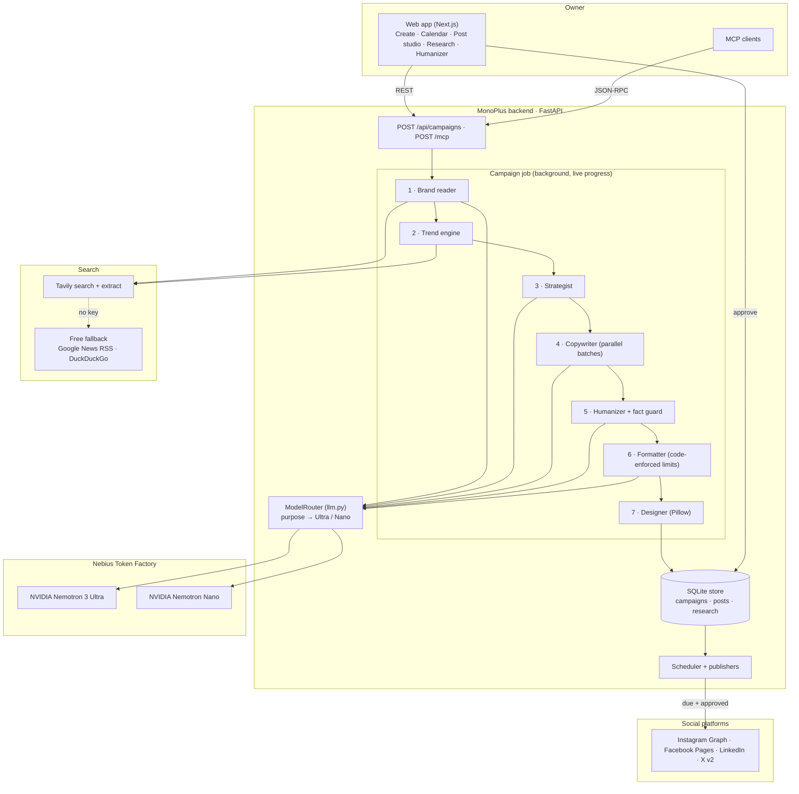

# MonoPlus

**MonoPlus** is an autonomous social media agent for small businesses. Give it a website or an Instagram handle and it reads the brand, checks this week's industry news, plans a content strategy, writes and humanizes a month of posts, designs branded images and carousels, and publishes approved posts on schedule to Instagram, Facebook, LinkedIn and X. The owner's only job is to approve.

Every AI step runs on **NVIDIA Nemotron** served by **Nebius Token Factory**, with Nemotron 3 Ultra for reasoning and writing and Nemotron Nano for fast structured calls. Live search comes from **Tavily**.

Built for the **Nebius x NVIDIA Global AI Hackathon**, **Best Apps and Agents** track (also entering Best Use of Tavily). License: [MIT](LICENSE).

## Core Features

- **One-input brand reading**: Scrapes the website for name, logo, colour palette and tone of voice, and builds an editable brand kit. Colours come from the logo first, so a store platform's stylesheet can't hijack the palette. Given only a social handle, it finds the official site first.
- **Real products and photos**: Finds the site's actual products (name, price as displayed, collection, link and full-size photo) from schema.org data, store product tiles, Shopify's product feed or generic product cards, plus the site's own photos. Posts feature these real products, prices and photos instead of generic graphics.
- **Live trend awareness**: Searches the last 14 days of industry news with Tavily so posts reference what is actually happening, and keeps each source link on the post.
- **A strategy specific to each brand**: Nemotron 3 Ultra plans the positioning, audience, four content pillars and weekly themes from the brand's own facts, read from its site:
  - what it sells and its product lines;
  - its price range and current sales;
  - who it's for (men, women, kids);
  - its country (from Shopify store data, the domain, the currency or addresses).

  Weekly themes are planned around that country's seasonal moments, such as 11.11, Black Friday / White Friday, wedding season, Ramadan and Eid, Diwali and Christmas. Only news that's actually about the brand or what it sells is used; corporate and generic market reports are dropped. Without a key, an industry playbook (footwear, fashion, food, beauty, fitness, software, real estate and more) is filled in with the same facts.
- **Every post, made for every platform**: Each post idea gets its own version for Instagram (4:5 image, hook-first caption, "link in bio"), Facebook (square, conversational, asks a question), LinkedIn (square, more professional) and X (16:9, one short line with the link). All versions share the idea, product, photo and image headline, and each is posted at that platform's best hour. A carousel idea is a carousel on Instagram and LinkedIn and a single image elsewhere.
- **No monotonous feed**: a variety engine ([variety.py](backend/app/agents/variety.py)) keeps a month of posts from feeling like one post 30 times.
  - **Post types:** a campaign mixes product spotlights, "this or that" duos (two products, vote A or B), sale posts with a % badge, styling tips, brand-quote graphics, seasonal-moment posts, questions and carousels. The same type never runs twice in a row, and never features the same product twice in a row.
  - **Captions with different shapes:** each caption is a plain statement, a hook line first, a short fact list, a tiny story, a closing question or one punchy line, rotated so neighbouring posts and a post's platform versions read differently (the model gets the same plan). Products that share a generic name ("3-Piece Co-ord Set") are named by their collection, and navigation menus scraped as sentences never become brand quotes.
  - **Greeting posts:** on Eid, Ramadan, Mother's, Father's and Women's Day, Independence Day, Christmas, Diwali, New Year and Valentine's Day inside a campaign, that day's first post is a warm greeting from the brand (no selling) on a festive card with the occasion's colours and motif.
  - **Wording:** every angle has several headline, idea, ending and call-to-action variants, rotated so phrasing doesn't come back until all are used.
  - **Looks:** layouts rotate between photo with text at the bottom, photo with text at the top, framed photo, duo and graphic, so neighbouring posts never look alike.
  - **Repetition check:** a final check replaces any repeated headline, including ones a model wrote. The Strategy tab shows the content mix.
- **Parallel copywriting**: Captions and carousel slides are generated in concurrent batches. A post's platform versions always go in the same batch so they stay consistent, and a 30-day, four-platform campaign (120 versions) takes minutes.
- **Fact-guarded humanizer**: Detects AI-writing patterns and rewrites them, and rejects any rewrite that changes a price, date, link, @handle or #hashtag.
- **Branded design**: Renders single images and 1080×1350 carousels (cover, one page per product, CTA) with the brand's logo at the top, its colours, and the product's price. Photo posts rotate through five looks (full photo, a tilted brand-colour poster ribbon, a framed photo, a minimal gallery card, a this-or-that duo) and text positions, and carousel covers vary too, so no two neighbouring posts look alike. It uses the brand's own photos first, then licensed stock or uploads. No watermarks.

- **Reels from any post**: One click turns a post into a 10–15 second 1080×1920 video for Instagram Reels, TikTok, YouTube Shorts and Facebook Reels. Nemotron writes the on-screen script (a hook, a few words per photo, a call to action); the video shows the brand's real product photos in one of five styles that differ in layout, motion, type, transitions and pace: Cinematic (slow zooms, crossfades), Fast cuts (zoom punches, white flashes, tilted caption blocks), Showcase (floating photo cards that push in), Magazine (an editorial page with words that write themselves on and a wipe) and Scrapbook (polaroids dropping onto a pile, sticker prices). A campaign's reels rotate through the styles so they never all look alike, and the owner can pick one.
  - **One story per reel:** every reel has a topic (product showcase, top picks countdown, tips, this or that, brand story or an occasion). The opening makes a promise ("3 ways to wear the X", "Our top 3 right now"), each scene delivers the next part of it with an on-screen label (Tip 1, #3, A), and the end card pays it off ("Which tip will you try?"). The default topic follows the post's type and a fresh script moves on to another.
  - **Occasions:** Eid al-Fitr and al-Adha, Ramadan, Mother's, Father's and Women's Day, Independence Day (in the country's colours), an anniversary, sales (11.11, Black Friday), New Year, Valentine's, Christmas and Diwali, each with its greeting, festive colours and an animated motif (a crescent and lanterns, floating hearts, bunting, confetti, sparkles). Occasions near the post come first.
  - **Colours, pace and lettering:** palettes worked out from the brand (its own colours, Night, Soft, Pop), curated ones (Mono, Sunset, Ocean, Forest, Berry), festive colours or any custom colour; relaxed, normal or snappy pacing; capitals or not. Reels nobody customised rotate through on-brand palettes.
  - **Trending formats and languages:** a trending-format topic uses formats people know from their feeds (POV, "this is your sign to try X", rate these 1 to 10, wait for the last one, "tell me you're from Karachi without telling me"), never claiming facts. Reel words can be English, Roman Urdu, Urdu or English mixed with Roman Urdu; Urdu is shaped (joined letters, right to left) before it's drawn. Captions switch language from the Caption tab: with Nemotron they're rewritten (facts guarded), without it a trending opener and closer in that language frame the caption.
  - **Humanized words:** written scripts go through the humanizer (the model pass when a key is set, then the rule pass) before they're shown, and a "Humanize words" button does the same for the owner's own edits, with an AI-tell score before and after. Frames are drawn with Pillow on several threads and encoded with ffmpeg (H.264 plus a silent track, so each app's licensed music can be added when posting). Every scene stays editable: change its words or price, swap its photo for another from the campaign, the website or an upload, reorder, add or remove scenes, see a live still of the scene, then render again.
- **Scheduling and direct posting**: Drag-and-drop calendar, one-click approval, and automatic publishing at each post's time through the official Instagram Graph, Facebook Pages, LinkedIn and X v2 APIs.
- **Competitor research and strategy agent** ([competitors.py](backend/app/agents/competitors.py)): this runs automatically for every new campaign, from the Research tab, or from the command line (`python scripts/competitor_research.py bata.com.pk`). It works in four steps:
  1. **Finds competitors:** a few web searches ("X competitors", "brands like X", "best footwear brands in Pakistan"), plus reading the round-up articles they return for brands linked to their own websites. It also uses any competitors you name. With a key, Nemotron picks the direct competitors.
  2. **Reads each competitor's site:** prices, sales and discount depth, product lines, who they sell to, service promises (delivery, returns, cash on delivery, instalments) and the social platforms they use. For Shopify stores whose pages refuse automated visits, it reads their public store data instead.
  3. **Compares** them with the brand in plain, sourced facts: price position, who's discounting, gaps and strengths.
  4. **Writes the advice:** recommendations (what, why, how), a 4-week plan tied to the brand's seasonal calendar, and content ideas. Nemotron writes these when configured; otherwise rules derived from the comparison do.

  The results appear in the Research tab and on the campaign's Strategy tab, and can be attached to future campaigns.
- **Market research agent**: Plans searches, reads sources and writes a cited report with content ideas that can be attached to a campaign.
- **MCP server**: Seven tools at `POST /mcp` (MCP 2025-11-25, Streamable HTTP) let other agents and assistants run campaigns.
- **Live pipeline view**: The web app shows each pipeline step as it runs, with timings and results.

## Architecture

### Video Demo

_TODO: public YouTube link (3 minutes or less)._

MonoPlus is a FastAPI backend that runs each campaign as a background job made of seven named steps, plus a Next.js web app that polls the job and renders the results. All state lives in SQLite (one row per campaign, written only when it changes). Every model call goes through a single router that sends each *purpose* to Nemotron 3 Ultra or Nemotron Nano on Token Factory.



Plain-text version (for contexts that don't render Mermaid):

```text
 Web app ──REST──▶ POST /api/campaigns          MCP client ──JSON-RPC──▶ POST /mcp
                         │                                                  │
                         └───────────────┬──────────────────────────────────┘
                                         ▼
   Campaign job ─ 1 Brand reader ─ 2 Trends ─ 3 Strategy ─ 4 Copy ─ 5 Humanize ─ 6 Format ─ 7 Render
                       │              │           │           │          │           │
                       │           Tavily         └──── ModelRouter ─────┘───────────┘
                       │       (or free search)    Ultra: strategy, copy, humanize
                       └──── Nano: brand extract   Nano:  brand extract, SEO
                                         ▼
                              SQLite store (campaigns, posts, research)
                                         ▼
          owner approves ──▶ Scheduler (every minute) ──▶ Instagram / Facebook / LinkedIn / X
```

### Data flow

1. **Create**: `POST /api/campaigns` (or the `create_campaign` MCP tool) validates the request, saves a `GENERATING` campaign, and starts a background job. It returns `campaign_id` and `job_id` immediately (`202`).
2. **Brand reader**: Fetches the site through the SSRF guard and extracts the logo, the palette (logo colours first, then the theme colour, then ranked stylesheets), real products with prices and photos ([scraper/products.py](backend/app/scraper/products.py)), and the site's own images. Nemotron Nano turns the page text into a structured brand profile.
3. **Trend engine**: Runs Tavily news (last 14 days) and general searches built from the brand's industry and keywords, then merges and dedupes them.
4. **Strategist**: Nemotron 3 Ultra receives the brand facts, the relevant trends and the seasonal calendar for the brand's country ([calendar.py](backend/app/agents/calendar.py)), and returns JSON with positioning, audience, voice rules, four pillars and weekly themes. Without a model, the industry playbook ([playbooks.py](backend/app/agents/playbooks.py)) builds the same plan from the same facts.
5. **Copywriter**: Builds the posting calendar in code, assigns a real product to each post (and a few more to each carousel), then sends batches of `COPY_BATCH_SIZE` posts to Nemotron 3 Ultra concurrently. Each batch returns JSON captions, CTAs and carousel slides.
6. **Humanizer**: Scores every caption for AI-writing patterns, rewrites the ones that score high, and keeps a rewrite only if the fact guard passes and the score drops.
7. **Formatter**: Nemotron Nano proposes hashtags, alt text and SEO phrases; code normalizes hashtags and enforces each platform's character limit.
8. **Designer**: Downloads each product's photo (through the SSRF guard, once per photo) and Pillow renders every image and carousel page into `/media`. The campaign becomes `DRAFT`.
9. **Review and publish**: The owner edits and approves posts in the web app (or by MCP). With auto-publish on, the scheduler checks every minute and posts each approved post at its time through the official APIs, recording the remote id and URL.

### Run states

- **Campaign:** `GENERATING → DRAFT → APPROVED → PUBLISHED`, or `FAILED`.
- **Post:** `DRAFT → APPROVED → PUBLISHED`.
- **Job step:** `pending → running → done`, `skipped` or `error`, with seconds and a result summary per step.
- **Research task:** `pending → running → completed`, `failed`, or `retry` (set when a server restart interrupts a run).

### Safety properties

- **The model never decides a fact the code can check.** Prices, dates, links, handles and hashtags are compared before and after every rewrite, and a rewrite that changes any of them is discarded. Prices stay exactly as displayed on the site.
- **Structured output only.** Every model call that feeds the app requests JSON, which is validated against Pydantic models. If output is malformed, the step falls back to deterministic template copy instead of showing raw model text.
- **Writes are deterministic code.** Models only return text and JSON. Publishing, scheduling and storage are plain Python.
- **No double posting.** Each post is locked while publishing, and a post that is already published returns `409`.
- **SSRF guard.** Every server-side fetch of a user-supplied URL (websites, logos, photos, webhooks) is checked on each request, including redirects. Private, loopback and link-local addresses are blocked.
- **Access key.** With `MONOPLUS_ACCESS_KEY` set, every `/api` call and `/mcp` need the key. The web app asks for it once.
- **No secrets in the UI.** Tokens and model details never reach the browser.

### How NVIDIA Nemotron on Nebius Token Factory is used

All model calls go through `ModelRouter` ([backend/app/llm.py](backend/app/llm.py)), which uses the OpenAI-compatible Token Factory API. Agents never name a model; they pass a **purpose**, and `PURPOSE_TIER` maps it to a tier. This follows the track brief's guidance: Ultra for serious reasoning, Nano for fast everyday calls.

| Purpose | Tier | Model (default) | Called from |
| --- | --- | --- | --- |
| `strategy` | Ultra | `nvidia/NVIDIA-Nemotron-3-Ultra` | strategist |
| `copywriting` | Ultra | Nemotron 3 Ultra | strategist (parallel batches) |
| `humanize` | Ultra | Nemotron 3 Ultra | humanizer (rewrite and Deep translation chain) |
| `rewrite` | Ultra | Nemotron 3 Ultra | post editor tone rewrite |
| `research_plan`, `research_report` | Ultra | Nemotron 3 Ultra | research agent |
| `brand_extract` | Nano | `nvidia/NVIDIA-Nemotron-Nano-9B-v2` | brand reader |
| `format_seo` | Nano | Nemotron Nano | formatter |
| `insight_extract` | Nano | Nemotron Nano | research agent |

Shared mechanics:

- **Model auto-selection**: On the first call the router lists the models available to the key. If a configured id isn't offered, it picks the closest Nemotron Ultra or Nano instead of failing.
- **Fast Nano calls**: Nano prompts are prefixed with `/no_think` and use low temperatures. `<think>` blocks are stripped from every response before parsing.
- **Bounded concurrency**: Copy batches run in parallel under a semaphore, with timeouts (`LLM_TIMEOUT_S`) and retries.
- **Telemetry**: Every call records tier, model, purpose, latency, token counts and errors. `GET /api/telemetry` returns them, which shows the Ultra/Nano split for a campaign.

### How Tavily is used

| Where | Tavily call | Purpose |
| --- | --- | --- |
| Trend engine ([trends.py](backend/app/agents/trends.py)) | `search` with `topic="news"`, `days=14`, plus general search | This week's industry news and trending topics; source links stay on posts |
| Brand reader ([ingestor.py](backend/app/scraper/ingestor.py)) | `search` | Find a business's official website from a social handle |
| Research agent ([research.py](backend/app/agents/research.py)) | `search`, then `extract` | Read full source pages before Nemotron writes the cited report |

Without `TAVILY_API_KEY`, free Google News RSS and DuckDuckGo are used ([freesearch.py](backend/app/agents/freesearch.py)), and the research agent writes an extractive summary.

### Agents

| Agent | File | Pipeline step | Input → Output | Model / tools |
| --- | --- | --- | --- | --- |
| **Brand reader** | `scraper/ingestor.py` | `ingest` | URL or @handle → `BrandKit` | Nemotron Nano; HTTP fetch (SSRF-guarded); Tavily search for handles |
| **Trend engine** | `agents/trends.py` | `trends` | `BrandKit` → `list[TrendItem]` | Tavily search (no model) |
| **Strategist** | `agents/strategist.py` | `strategy` | `BrandKit` + trends → `CampaignStrategy` | Nemotron 3 Ultra |
| **Copywriter** | `agents/strategist.py` | `copy` | strategy + calendar slots → `list[SocialPost]` | Nemotron 3 Ultra, parallel batches |
| **Humanizer** | `agents/humanizer.py` | `humanize` | caption → rewritten caption + before/after score | Rule pass, then Nemotron 3 Ultra; fact guard in code |
| **Formatter** | `agents/formatter.py` | `format` | posts → hashtags, alt text, SEO keywords | Nemotron Nano; limits enforced in code |
| **Designer** | `agents/renderer.py` | `render` | post + brand kit → PNG images | Pillow (no model) |
| **Reel maker** | `agents/reels.py` | on demand | post + brand photos → 9:16 MP4 | Nemotron 3 Ultra script (rule-based fallback); Pillow + ffmpeg |
| **Research agent** | `agents/research.py` | separate task | topic → cited report + `ResearchInsights` | Ultra plans, Tavily searches and extracts, Ultra writes, Nano extracts insights |

Key design points:

- **Models propose; code disposes.** No agent can publish, schedule or delete. Those are REST and scheduler actions in plain Python.
- **Two of the seven steps use no model at all.** Trends come from search results and images from deterministic rendering, so they are reproducible.
- **Every model step has a deterministic fallback.** With no key, the pipeline still completes using template copy and the rule-based humanizer, and the campaign is marked `mode: "demo"`.
- **Missing evidence is reported, never invented.** If search returns nothing, research says so instead of citing made-up sources. A thin brand kit triggers a banner asking the owner for more detail.

## Stack

**Backend:**
- Python 3.12, FastAPI, Pydantic v2
- NVIDIA Nemotron 3 Ultra and Nemotron Nano via Nebius Token Factory (`openai` SDK)
- Tavily (`tavily-python`); free search fallback over httpx
- Pillow (rendering), BeautifulSoup (scraping)
- Instagram Graph, Facebook Pages, LinkedIn Posts/Images and X v2 APIs
- pytest with `httpx.MockTransport`

**Web app:**
- Next.js 14 (App Router), TypeScript, Tailwind CSS
- lucide-react icons, react-markdown

## Project structure

```text
├── backend/
│   ├── app/
│   │   ├── main.py                 # FastAPI app: REST API, access-key middleware, scheduler startup
│   │   ├── llm.py                  # ModelRouter: purpose → Nemotron Ultra/Nano, auto-selection, telemetry
│   │   ├── config.py               # Environment settings
│   │   ├── schemas.py              # Pydantic models (BrandKit, Campaign, SocialPost, Job, ResearchTask…)
│   │   ├── store.py                # SQLite store (imports an older db.json once)
│   │   ├── netguard.py             # SSRF guard for every outbound fetch
│   │   ├── publishing.py           # Direct publishing, per-post lock, auto-publish scheduler
│   │   ├── mcp_server.py           # MCP server (2025-11-25, Streamable HTTP), seven tools
│   │   ├── agents/
│   │   │   ├── pipeline.py         # Campaign job: seven named steps with live progress
│   │   │   ├── strategist.py       # Strategy + copywriting (parallel batches) + fallbacks
│   │   │   ├── humanizer.py        # AI-pattern detection, rewrite, translation chain, fact guard
│   │   │   ├── formatter.py        # Hashtags, alt text, SEO, platform limits
│   │   │   ├── renderer.py         # Pillow images and carousels
│   │   │   ├── reels/             # 9:16 motion videos: story, draw, colours, styles, render
│   │   │   ├── photos.py           # Pexels / Openverse stock photos, uploads
│   │   │   ├── trends.py           # Tavily search + extract
│   │   │   ├── freesearch.py       # Google News RSS / DuckDuckGo fallback
│   │   │   ├── research.py         # Research agent
│   │   │   └── memory.py           # Research library
│   │   ├── scraper/                # Brand reader (logo, palette, products, prices)
│   │   └── social/                 # Instagram, Facebook, LinkedIn, X clients
│   ├── tests/                      # 109 tests, network mocked
│   ├── Dockerfile
│   └── requirements.txt
├── frontend/                       # Next.js web app
│   ├── app/                        #   Create, campaigns/[id], research, humanizer
│   ├── components/                 #   CalendarView, PostEditor, BrandKitPanel, QueueList, Sidebar…
│   └── lib/api.ts                  #   Typed API client
├── third_party/                    # Licences and notices for the humanizer projects
├── .env.example
└── LICENSE                         # MIT
```

## API

All endpoints are under `http://localhost:8000`. With `MONOPLUS_ACCESS_KEY` set, send it as `X-Access-Key`.

### `POST /api/campaigns`

Starts a campaign job and returns immediately.

```json
{
  "input": "https://www.tartinebakery.com",
  "platforms": ["instagram", "linkedin"],
  "days": 7
}
```

`input` is a website URL or an @handle. `platforms` defaults to Instagram, LinkedIn and X; `days` is 1–31 (default 30); `start_date`, `posts_per_day` (1–3) and `research_ids` (up to three completed research tasks) are optional.

Response (`202`):

```json
{ "campaign_id": "76226cebde6f", "job_id": "f21975ff6184" }
```

### `GET /api/jobs/{job_id}`

Live progress, which the web app polls while a campaign generates. Real response from a run (trimmed):

```json
{
  "id": "f21975ff6184",
  "campaign_id": "76226cebde6f",
  "status": "running",
  "steps": [
    { "key": "ingest",   "label": "Reading your site & building the brand kit", "status": "done", "detail": "Tartine Bakery · Food & Beverage", "seconds": 0.95 },
    { "key": "trends",   "label": "Checking today's news & trends",             "status": "done", "detail": "10 live items" },
    { "key": "strategy", "label": "Planning the content strategy",              "status": "done", "detail": "Behind the Scenes, Customer Wins, Quick Tips, Offers & News" },
    { "key": "copy",     "label": "Writing the posts",                          "status": "done", "detail": "7 drafts · 2 carousels" },
    { "key": "humanize", "label": "Making the copy sound human",                "status": "done", "detail": "AI-tell score 3 → 0" },
    { "key": "format",   "label": "Hashtags & SEO",                             "status": "done" },
    { "key": "render",   "label": "Designing the visuals",                      "status": "running" }
  ],
  "brand": { "name": "Tartine Bakery", "industry": "Food & Beverage", "primary_color": "#C87E1E", "accent_color": "#FFBC7D", "logo_url": "https://tartinebakery.com/wp-content/uploads/2025/07/favicon.png" }
}
```

### `GET /api/campaigns/{campaign_id}`

The full campaign: brand kit, strategy, trends, and every post with caption, hashtags, alt text, image URLs, `publish_at` and status.

### `PATCH /api/posts/{post_id}`

Edit and re-render a post. Any of `headline`, `caption`, `cta`, `hashtags`, `publish_at`, `status`, `layout` (`bold | split | quote | photo`), `slides`, `text_position`, `text_scale` (0.6–1.5).

### `POST /api/posts/{post_id}/reel`

Makes a 9:16 MP4 reel of the post and attaches it to every platform version (`video_url`, `video_poster`, and the editable `reel_scenes`). Send `{"scenes": [...]}` to render the owner's edited scenes instead of writing a new script; `GET /api/posts/{post_id}/reel/photos` lists the photos a scene can use. Returns the post plus `seconds`, the script's `scenes`, `used_llm` and `render_ms`. Reels are included in the campaign export under `reels/`.

### Posting from MonoPlus's browser

The same way Claude posts for you: MonoPlus opens LinkedIn, Facebook, Instagram or X in its own browser window on your
computer (a saved Chromium profile in `data/browser-profile`), where you sign in once yourself. For a post it opens the
composer, attaches the images or the reel, types the caption, and either leaves it for you to check and press Post
("Fill in for review") or presses Post itself. With "post approved posts automatically" on, scheduled posts go out the same
way for platforms that have no API connection. No developer apps or API approvals are needed.

- `GET /api/browser` shows where the browser is signed in; `POST /api/browser/login/{platform}` opens a sign-in page.
- `POST /api/posts/{post_id}/browser-post` with `{"submit": false|true, "media": "images"|"reel"}`.
- `PUT /api/browser/scheduled` turns scheduled browser posting on or off.

It needs Playwright (`pip install playwright && python -m playwright install chromium`) and a screen, so it runs where
MonoPlus runs on your own computer, not on a headless server. Platforms change their pages and discourage automated
posting: each step looks for its button several ways and says which step failed, and review mode is the default.

### `POST /api/posts/{post_id}/publish`

Posts directly to the platform's API and returns the post with `remote_id` and `remote_url`. Returns `400` if the platform isn't connected and `409` if the post is already published.

### `POST /api/humanize`

```json
{ "text": "In today's fast-paced world, our seamless sourdough is a game-changer - only $12!", "mode": "light" }
```

Real response (trimmed):

```json
{
  "text": "Our smooth sourdough is a big deal - only $12!",
  "before": 22,
  "after": 0,
  "patterns_before": [
    { "id": "ai_words",   "label": "Overused AI words",     "count": 2, "example": "seamless" },
    { "id": "inflation",  "label": "Inflated significance", "count": 1, "example": "In today's fast-paced" }
  ],
  "steps": [
    { "name": "Original",  "score": 22, "accepted": true },
    { "name": "Rule pass", "score": 0,  "accepted": true }
  ]
}
```

`mode` is `light`, `standard` or `deep` (Nemotron translation chain). The `$12` survives because the fact guard protects it.

### `POST /api/research/tasks`

```json
{ "topic": "salad chain customer complaints 2026", "region": "US" }
```

Creates a research task; poll `GET /api/research/tasks/{id}` for the cited `report`, `sources` and `insights` (trend, pricing gap, audience insight, content angles, confidence).

### Other endpoints

| Endpoint | Purpose |
| --- | --- |
| `GET /api/health` | Which services are connected (Nemotron, Tavily, Pexels, MCP endpoint) |
| `GET /api/telemetry` | Model calls: tier, model, purpose, latency, tokens |
| `GET /api/models` | Models available to the Token Factory key |
| `POST /api/campaigns/{id}/approve-all` | Approve every draft |
| `PATCH /api/campaigns/{id}/brand` | Edit colours, logo, name, voice; every post re-renders |
| `GET /api/campaigns/{id}/export` | ZIP of images, captions and a CSV schedule |
| `GET /api/upcoming` | Unpublished posts in the next days, across campaigns |
| `POST /api/posts/{id}/background` | Set a stock or uploaded photo |
| `POST /api/posts/{id}/humanize`, `/rewrite` | Humanize a caption, or rewrite it in a new tone (Nemotron) |
| `GET /api/photos/search`, `POST /api/uploads` | Licensed stock photo search, image upload |
| `GET /api/publishing`, `PUT /api/publishing/auto` | Connected platforms; turn auto-publishing on or off |
| `POST /mcp` | MCP endpoint (see below) |

### MCP server

`POST /mcp` implements MCP **2025-11-25** over Streamable HTTP ([backend/app/mcp_server.py](backend/app/mcp_server.py)). It also negotiates 2025-06-18 and 2025-03-26, issues `Mcp-Session-Id`, validates `MCP-Protocol-Version` and `Origin`, and accepts the access key as a Bearer token.

| Tool | What it does |
| --- | --- |
| `create_campaign` | Start a campaign from a website or handle |
| `get_campaign_status` | Live step progress, then post, approval and next-post counts |
| `list_upcoming_posts` | Unpublished posts in the next N days, with image links |
| `approve_posts` | Approve all drafts or specific posts |
| `humanize_text` | Fact-guarded rewrite with before and after scores |
| `research_market` | Cited research summary with content ideas |
| `get_brand_profile` | Colours, logo, voice and value props |
| `make_reel` | Turn a post into a 9:16 reel and return the video link |

The server was verified with the official MCP Python SDK client, which negotiated `2025-11-25`, listed all the tools, and ran a full campaign.

## Run locally (step-by-step)

### Prerequisites

- Python 3.12+ and Node 18+
- A Nebius Token Factory API key (https://tokenfactory.nebius.com)
- Optional: a Tavily API key, a Pexels API key

### 1. Configure the environment

```bash
cp .env.example .env
```

Set at least `NEBIUS_API_KEY`. Add `TAVILY_API_KEY` for live search and `PEXELS_API_KEY` for instant stock photos. The default model ids are corrected automatically if your key offers different Nemotron versions.

### 2. Start the backend

```bash
cd backend
python -m venv .venv
.venv/bin/pip install -r requirements.txt          # Windows: .venv\Scripts\pip
.venv/bin/uvicorn app.main:app --port 8000          # Windows: .venv\Scripts\uvicorn
```

### 3. Check the connections

```bash
curl -s localhost:8000/api/health
```

```json
{ "ok": true, "mode": "live", "ai_provider": "nebius", "nebius": true, "tavily": true, "free_search": true, "pexels": false, "mcp_endpoint": "http://localhost:8000/mcp" }
```

`"mode": "demo"` means no model key was found; the app still runs on fallbacks.

### 4. Start the web app

```bash
cd frontend
npm install
npm run dev            # http://localhost:3000
```

### 5. Generate a campaign

Paste a website (for example `https://www.sweetgreen.com`) on the Create page, pick platforms and days, and press Generate. Or use curl:

```bash
curl -s localhost:8000/api/campaigns -H 'Content-Type: application/json' \
  -d '{"input":"https://www.tartinebakery.com","platforms":["instagram"],"days":7}'
curl -s localhost:8000/api/jobs/<job_id>
```

### 6. See the Ultra/Nano split

```bash
curl -s localhost:8000/api/telemetry
```

### 7. Test the MCP server

```bash
npx @modelcontextprotocol/inspector      # Transport: Streamable HTTP, URL: http://localhost:8000/mcp
```

### 8. Connect direct posting (optional)

Fill in the `META_*`, `INSTAGRAM_ACCOUNT_ID`, `LINKEDIN_*` and `X_USER_ACCESS_TOKEN` values in `.env` (the required permissions are listed there), restart the backend, and use **Post** in the post editor or turn on auto-publishing.

### 9. Run the tests

```bash
cd backend && .venv/bin/python -m pytest -q
```

There are 109 tests, with every external API mocked. They cover:

- the pipeline and model router
- scraping and the humanizer's fact guard
- rendering and carousels
- research and free-search parsing
- each publishing API's request sequence
- the MCP protocol and tools
- the access key, SSRF guards and scheduling

### Try it without paying for anything

With no keys at all, everything still runs:

- template captions instead of Nemotron copy
- the rule-based humanizer
- free web search and extractive research summaries
- rendering, scheduling, export and the MCP server

## Deploy

[backend/Dockerfile](backend/Dockerfile) builds the API. Run it on Nebius AI Cloud (a VM or Serverless Endpoint) or any container host, then:

- Set `NEBIUS_API_KEY`, `TAVILY_API_KEY` and `MONOPLUS_ACCESS_KEY`.
- Set `PUBLIC_API_URL` and `PUBLIC_APP_URL` to the public URLs, and `CORS_ORIGINS` to the web app's origin.
- Mount a persistent volume at `/data` (the SQLite database and rendered media). Unused media older than two days is
  cleaned up at start and through `POST /api/maintenance/cleanup`.
- Set `MONOPLUS_ACCESS_KEY` before putting the app online; the server warns at start when it isn't set.

The web app is a standard Next.js build with `NEXT_PUBLIC_API_URL` pointing at the API.

## Error handling

| Situation | Response |
| --- | --- |
| Campaign, post, job or research not found | `404` with a clear message |
| Missing or wrong access key | `401` |
| Invalid input (bad colour, `days` out of range, short input) | `422` with the failing field |
| Research attached to a campaign before it's completed | `422` |
| Tone rewrite with no Nemotron key | `503` explaining that the caption can still be edited by hand |
| Token Factory or rewrite failure | `502` with the error; the campaign pipeline itself falls back to template copy instead of failing |
| Posting to a platform that isn't connected | `400` naming the platform |
| Publishing a post that is already published | `409`; nothing is sent twice |
| Platform API rejects a post | `502`; the post keeps its status and records `publish_error` |
| Website unreachable, private or internal URL | Brand reader refuses the fetch (SSRF guard); the campaign fails with a readable message |
| Thin website | Campaign completes, and a banner asks the owner to add detail to the brand kit |
| Search off or no results | Research says so explicitly; no invented sources |
| Server restarted mid-research | Task is marked `retry` instead of hanging |
| MCP: unknown tool / bad arguments | JSON-RPC `-32602`; tool failures return `isError: true` with a readable message |
| MCP: unknown session / unsupported version / bad Origin | `404` / `400` / `403` |

## Logging and telemetry

- **Model calls**: `GET /api/telemetry` records tier, model, purpose, latency, token counts and errors for every call. API keys are never included.
- **Pipeline**: every job step records its status, duration and a one-line result (`GET /api/jobs/{id}`), and the campaign keeps per-step timings.
- **Publishing**: each post records how it was published (`direct`, `webhook` or `manual`), the remote id and URL, or the platform's error.
- **Server log**: search fallbacks, model auto-selection and failed fetches are logged by the backend.

## Operations

- **Rate limits:** each client can start 6 campaigns per 10 minutes, make 12 reels per 5 minutes, run 10 research
  tasks per 10 minutes, upload 40 images and ask for 40 rewrites per 5 minutes (`MONOPLUS_RATE_LIMITS=0` turns them off).
- **Reel rendering:** `MONOPLUS_REEL_RENDERS` reels render at once (default 2); more wait their turn, and a queue of
  more than eight is asked to try again in a minute.
- **Time zones:** posts go out at each platform's best hour in the brand's own time zone (from its country).
- **Redrawing:** when post designs change, older campaigns show a banner to redraw their images with the newest
  designs, keeping their words, photos and approvals (`POST /api/campaigns/{id}/redraw`).
- **Checks:** GitHub Actions runs the backend tests and lint, the frontend lint, type check and build, and a browser smoke
  test that opens every page (`backend/scripts/ui_smoke.py`). Tests use their own temporary data folder, and the
  Nemotron code paths are exercised with a stand-in model (`tests/test_model_paths.py`).

## Limitations

- **Direct posting is untested on live accounts.** It is unit-tested against mocked Instagram, Facebook, LinkedIn and X APIs, and real use needs your own app credentials. Instagram requires a Business or Creator account linked to a Facebook Page.
- **Single-tenant by design.** One store for one business, protected by an optional access key; there are no user accounts.
- **Reels are motion graphics from photos.** Zooms, transitions and animated text over the brand's stills, with no footage,
  voiceover or music (music is added from each app's licensed library when posting).
- **Urdu is drawn in Segoe UI / DejaVu, not Nastaliq.** Proper Nastaliq needs a text-shaping engine Pillow doesn't ship with on
  Windows; the letters are joined and right to left, but the style is Naskh-like.
- **No feedback from results yet.** Learning from likes and reach needs each platform's insights API and approved apps.
- **Sites that draw everything with JavaScript and embed no data** still give no products; most embed their data
  (Next.js, Nuxt, Redux, JSON-LD, Shopify, Indolj), which MonoPlus reads.
- **No image-generation model.** Images are designed from templates, brand colours and licensed photos. This keeps them on-brand, but they are less varied than generated images.
- **Thin sites give thin brand kits.** A single landing page doesn't give much to work with; the app flags this and lets the owner edit the kit.

## Credits

The humanizer builds on two MIT-licensed projects (notices in [third_party/](third_party/)):

- [blader/humanizer](https://github.com/blader/humanizer): pattern catalogue from Wikipedia's "Signs of AI writing".
- [lynote-ai/humanize-text](https://github.com/lynote-ai/humanize-text): translation-chain "Deep" mode.

## Hackathon submission notes (for the author; fill in before submitting)

- **Demo video:** _TODO_. Show the problem in the first 20 seconds, then a real website going in, the live pipeline, posts and carousels, the telemetry Ultra/Nano split, and Tavily sources on a post.
- **Live demo URL:** _TODO_.
- **Feedback on Nebius Token Factory and NVIDIA Nemotron:** _TODO, in your own words: what worked, what didn't, onboarding, latency, cost. There's a prize for the most valuable feedback._
- **Existed before the submission period?** _TODO if applicable: explain what was significantly updated during it._
- **Builders & Brews city:** _TODO, if you attended._
